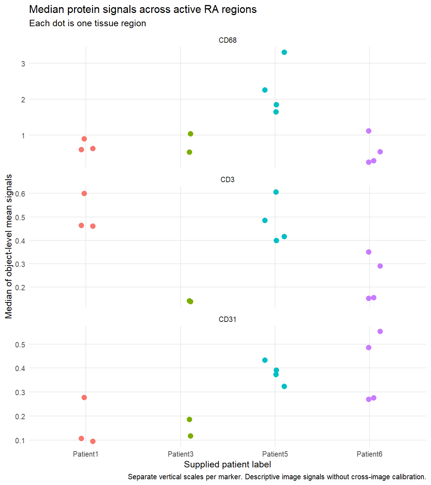
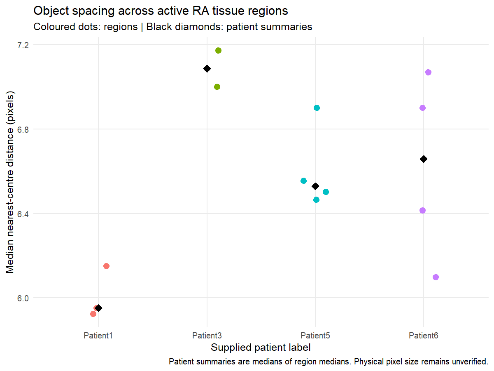
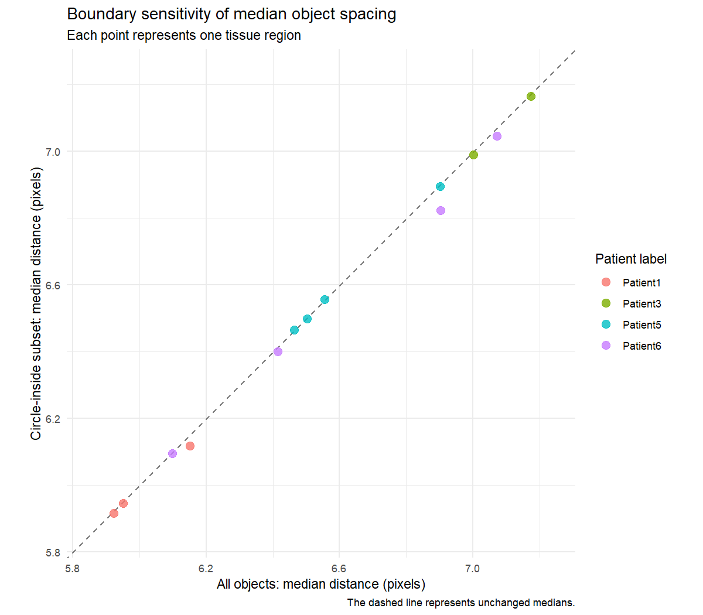
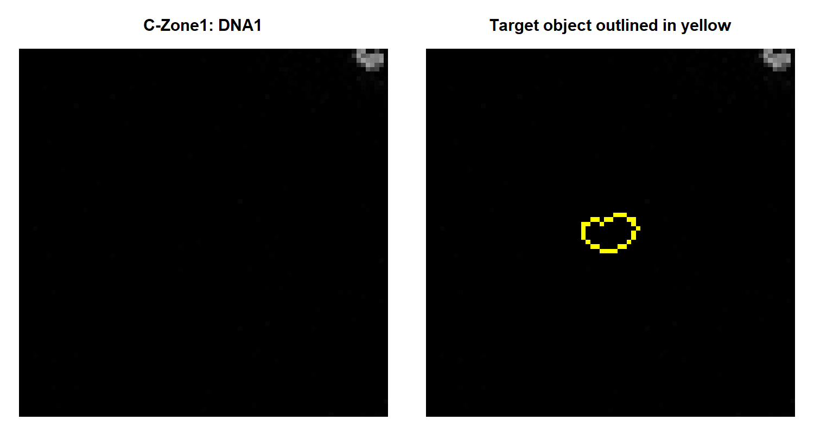

# Comparing spatial protein signals across rheumatoid arthritis tissue regions

A bioinformatics learning project by Seema Sharma using R and public imaging
mass cytometry data.

## Project question

How do measured protein signals and segmented-object spacing vary across
selected active rheumatoid arthritis synovial tissue regions?
  
  This is an exploratory analysis of existing data, not a claim of new
biological discovery.

## Data and scope

The analysis uses public synovial imaging mass cytometry data from the
[De Lima study, Zenodo version 2](https://zenodo.org/records/23392665).

Associated paper:
  [Spatial mapping of rheumatoid arthritis synovial niches reveals a LYVE1+
     macrophage network associated with response to therapy](https://doi.org/10.1016/j.ard.2025.07.019).

The dataset creator listed on Zenodo is Frédéric Blanchard.

We selected the 13 regions labelled **Active RA** in the supplied spreadsheet:
  
  | Supplied patient label | Study label | Number of regions |
  |---|---|---:|
  | Patient1 | RA1 baseline | 3 |
  | Patient3 | RA2 baseline | 2 |
  | Patient5 | RA3 baseline | 4 |
  | Patient6 | RA4 baseline | 4 |
  
  The supplied masks contain **43,782 segmented objects** across these regions.
Objects and regions from the same patient are not independent patients.

This project is separate from my earlier
[single-region spatial analysis](https://github.com/sharmaandseema/synovial-spatial-proteomics).

## Workflow

1. Verify the original archive using its published MD5 checksum.
2. Match sample information to image folders.
3. Test the workflow on two pilot regions.
4. Inspect masks and measure all 13 regions.
5. Summarise protein signals by region and supplied patient label.
6. Calculate nearest-object distances within each image.
7. Investigate unusual objects and check boundary sensitivity.
8. Rerun the analysis and compare the main output tables.

DNA1 was used for image review. CD68, CD3 and CD31 were measured as the mean
original image signal inside each positive mask label.

No background correction, cross-image signal calibration, positivity
thresholds or cell-type assignments were applied.

## Protein-signal summaries

Each coloured dot below represents one region. Its value is the median of
the object-level mean signals in that region.



Region medians vary both within and between supplied patient labels.
These differences may reflect tissue composition, acquisition, staining,
segmentation or sampling. They are not interpreted as disease-severity
rankings or confirmed biological differences.

Separate vertical scales are used for different markers. Their numerical
values should not be compared as calibrated protein concentrations.

Patient-level descriptive summaries use the **median of region medians**,
so each region contributes one value.

## Object spacing

For each object, we calculated the straight-line distance from its centre
to the closest other object centre **within the same image**.

Region median distances ranged from approximately **5.924 to 7.174 pixels**.



Coloured dots represent regions. Black diamonds represent each supplied
patient label's median of region medians.

Distances remain in pixels because physical pixel dimensions have not been
verified. They do not measure cell-boundary contact or demonstrate
biological communication.

## Quality review and boundary sensitivity

We compared summaries using:

- All supplied segmented objects.
- Objects whose masks do not touch the rectangular image border.
- Objects whose nearest-neighbour search circle fits inside the image.

All objects remained eligible as neighbours. The restrictions change which
objects contribute to summaries; they do not delete neighbour candidates
or recalculate distances after removal.



All region median-distance changes under the circle-inside restriction were
less than 0.1 pixel.

However, E-Zone1's maximum distance changed from **236.9 to 39.59 pixels**
  under either restriction. Its median remained near **6.56 pixels**.
This illustrates that stable medians can coexist with sensitive extremes.

Protein-median changes were also assessed. The largest absolute changes
across the two restrictions were approximately:
  
  | Marker | Largest absolute change | Region |
  |---|---:|---|
  | CD68 | 0.1151 | E-Zone2b |
  | CD3 | 0.00822 | E-Zone2b |
  | CD31 | 0.02122 | G-Zone2c |
  
  Changes are expressed in each marker's own image-signal units.

### Targeted object review

We inspected two objects selected after reviewing unusually large distances:

- **E-Zone1__748:** touches the image edge and contains signal in both DNA
  channels. Its nearest-neighbour distance may be affected by the boundary.
- **C-Zone1__3685:** has very little signal in both DNA channels, raising a
  segmentation concern.



Both objects remain in the baseline analysis. These targeted reviews do not
validate all masks or establish a general DNA-based exclusion rule.

## Reproduce the analysis

Open `ra-spatial-region-comparison.Rproj` in RStudio.

From the project root, run in the RStudio Console:

```r
source("scripts/25_run_all.R")
```

The runner installs missing required packages and executes scripts 00–24
in order. A verified cached archive is reused; if absent, the import script
downloads it. Internet access is needed for downloads or package installation.

An empty-workspace rerun completed successfully. Six main tables were
compared against their previous versions using a numerical tolerance of
`1e-10`.

On a first run without previous output tables, those comparisons are
recorded as unavailable.

Reproducibility records:

- `results/reproducibility_comparison.csv`
- `docs/reproducibility_run_log.txt`
- `docs/session_info_rerun.txt`

## Folder organisation

| Folder | Contents |
|---|---|
| `scripts` | Numbered analysis scripts and runner |
| `data_raw` | Original archive and extracted source files |
| `data_processed` | Derived object-measurement and QC tables |
| `results` | Region, patient and sensitivity summaries |
| `figures` | Saved analysis figures |
| `docs` | Source information, region manifest and session records |

## Limitations

- Only four supplied patient labels are represented, with unequal numbers
  of selected regions.
- Segmentation is supplied by the source study and was not comprehensively
  validated here.
- Unlabelled image pixels cannot automatically be treated as tissue-free
  background.
- No physical distance calibration or cross-image signal calibration was
  established.
- Boundary checks do not address internal tissue gaps or segmentation errors.
- No cell types, blood vessels, disease-severity relationships or spatial
  enrichment were established.
- The analysis is descriptive; no patient-group hypothesis tests were performed.

## Learning focus

This project helped me practise keeping objects, regions and patients
distinct; using consistent measurement rules; comparing summaries across
images; and investigating unusual results before interpreting them.